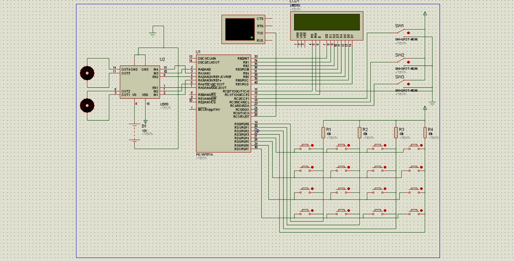
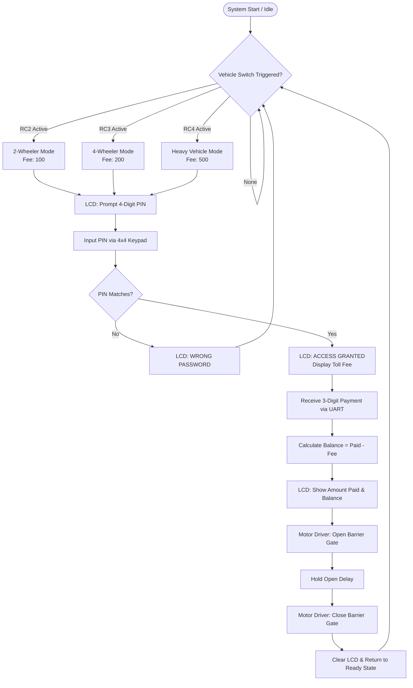

# Automated Toll Gate System using PIC16F877A & Proteus ISIS

An embedded microcontroller-based **Automated Toll Plaza & Gate Management System** implemented in **Embedded C** for the **PIC16F877A** microcontroller and designed for simulation in **Proteus ISIS**.

The system automates vehicle classification, security PIN authentication, toll fee collection via serial communication (UART), real-time LCD fee/balance display, and automated barrier gate actuation via an L293D motor driver.

---

## Circuit Schematic & Simulation



---

## Key Features

- **Categorized Vehicle Detection**: Supports multiple vehicle classes (2-Wheeler, 4-Wheeler, and Heavy Vehicle) selected via toggle/momentary switches.
- **PIN / Password Authentication**: 4x4 matrix keypad input with real-time LCD feedback to authenticate authorized vehicles.
- **Serial Payment Processing (UART)**: Communicates with a Virtual Terminal to input payment amounts, automatically calculating and displaying change/balance.
- **16x2 Alphanumeric LCD Display**: Provides instant visual feedback on vehicle type, password prompt, payment confirmation, and balance.
- **Dual Motor Barrier Actuator**: Powered by an L293D dual H-bridge motor driver to automatically open and close the toll barrier gate upon successful transaction.

---

## Vehicle Classification & Fee Structure

| Vehicle Class | Trigger Pin | Default PIN | Toll Fee | Gate Action |
|:--------------|:-----------:|:-----------:|:--------:|:-----------:|
| **2-Wheeler** | `RC2` | `1234` | ₹100 | Open ➔ Delay ➔ Close |
| **4-Wheeler** | `RC3` | `ABCD` | ₹200 | Open ➔ Delay ➔ Close |
| **Heavy Vehicle** | `RC4` | `AB12` | ₹500 | Open ➔ Delay ➔ Close |

---

##  Hardware Components & Pin Mapping

### 1. Microcontroller
- **Chip**: Microchip PIC16F877A
- **Clock**: 20 MHz (External Crystal / Ceramic Resonator)

### 2. 16x2 LCD Display (LM016L)
- **Data Bus (D0–D7)**: Connected to `PORTB` (`RB0` – `RB7`)
- **RS (Register Select)**: `RC0`
- **EN (Enable)**: `RC1`
- **R/W**: Connected to `GND` (Write Mode)

### 3. 4x4 Matrix Keypad
- **Rows**: `RD4`, `RD5`, `RD6`, `RD7`
- **Columns (with 10kΩ pull-down resistors)**: `RD0`, `RD1`, `RD2`, `RD3`
- Supports full alphanumeric entry (`0–9`, `A`, `B`, `C`, `D`, `*`, `#`).

### 4. Vehicle Mode Selection Switches
- **Switch 1 (2-Wheeler)**: `RC2`
- **Switch 2 (4-Wheeler)**: `RC3`
- **Switch 3 (Heavy Vehicle)**: `RC4`

### 5. UART Serial Communication (Virtual Terminal)
- **TXD (Transmit)**: `RC6`
- **RXD (Receive)**: `RC7`
- **Baud Rate**: 9600 bps (`SPBRG = 129`, `TXSTA = 0x24`, `RCSTA = 0x90`)

### 6. Motor Driver & Gate Motors (L293D)
- **Inputs**: Connected to `PORTA` (`RA0` – `RA5`)
- **Outputs**: Connected to DC motors acting as boom barriers
- **Opening sequence**: `PORTA = 0x2D`
- **Closing sequence**: `PORTA = 0x36`
- **Stop/Idle**: `PORTA = 0x00`

---

## How the System Works (Operational Flow)



---

## Repository Contents

```
toll-System/
├── toll system.c         # Primary Embedded C firmware (PIC16F877A)
├── toll system.hex       # Pre-compiled HEX firmware for Proteus simulation
├── toll system.mcp       # MPLAB IDE project configuration file
├── toll system.mcw       # MPLAB IDE workspace session file
├── toll2.c               # Refactored, modularized Embedded C firmware
├── toll2.hex             # Pre-compiled HEX binary for toll2
├── toll2.mcp             # MPLAB IDE project file for toll2
├── toll2.mcw             # MPLAB IDE workspace file for toll2
├── toll-design-img.png   # Proteus ISIS circuit schematic reference image
├── .gitignore            # Git ignore file for compiler build artifacts
└── README.md             # Project documentation
```

---

## How to Run in Proteus ISIS

1. **Open Proteus**: Launch Proteus Design Suite / ISIS.
2. **Open / Recreate Schematic**: 
   - If you have the `.DSN` design file, open it directly.
   - Otherwise, place the components as shown in `toll-design-img.png`:
     - `PIC16F877A`
     - `LM016L` (16x2 LCD)
     - `L293D` (Motor Driver) + 2 DC Motors
     - `VIRTUAL TERMINAL` (connected to `RC6`/TXD and `RC7`/RXD)
     - `BUTTON` / SPDT Switches on `RC2`, `RC3`, `RC4`
     - 4x4 Keypad matrix with 10kΩ pull-down resistors on `PORTD`
3. **Load the Firmware**:
   - Double-click on the **PIC16F877A** microcontroller.
   - In the **Program File** field, click the folder icon and select `toll system.hex` (or `toll2.hex`).
   - Set the **Processor Clock Frequency** to `20MHz` (or matching frequency).
   - Click **OK**.
4. **Start the Simulation**:
   - Click the **Play / Run** button at the bottom-left corner of Proteus.
5. **Simulate a Vehicle Passing**:
   - Press switch **SW1** (`RC2`) for 2-Wheeler.
   - The LCD will display `PASSWORD:`. Use the 4x4 keypad to type `1234`.
   - The LCD will show `ACCESS GRANTED` and `FEE : RS100`.
   - Open the **Virtual Terminal** window and type a 3-digit amount (e.g., `200`).
   - The LCD will show the amount paid and calculated balance (e.g., `balance=100`).
   - Watch the DC motors open the barrier, wait, and close automatically!

---

## Building / Modifying the Code (MPLAB IDE)

If you wish to edit or recompile the C source code:
1. Open **MPLAB IDE v8.x** (or MPLAB X with XC8 compiler).
2. Go to **Project > Open** and select `toll system.mcp` or `toll2.mcp`.
3. Ensure the compiler toolchain (e.g., **HI-TECH C Compiler for PIC10/12/16** or **MPLAB XC8**) is selected.
4. Make your code changes in `toll system.c` or `toll2.c`.
5. Click **Project > Build** (`F10`) to generate an updated `.hex` file.
